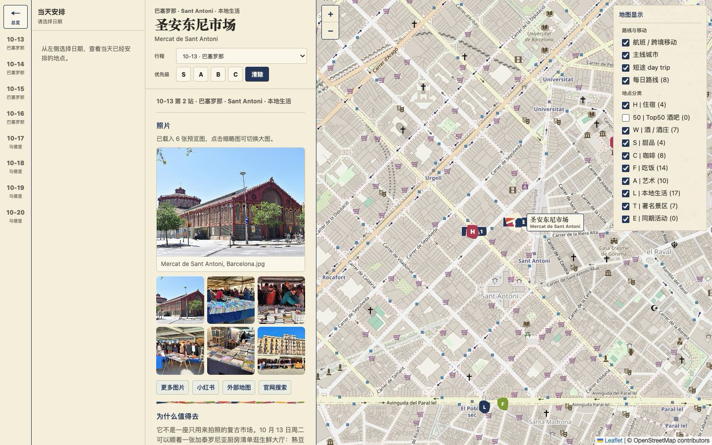

# Interactive Trip Planner

[中文](README.md) | **English**

## Bring your taste in everyday life to a city you've never visited

It goes beyond generating a list of attractions. It learns how you want to travel, combines local-language research with landmark context, neighborhood life, and practical constraints, then turns them into a comfortable, trustworthy itinerary you can keep editing.



> Use interactive-trip-planner to plan a first visit that includes both the city's defining places and the texture of local everyday life.

## How this differs from a typical AI itinerary

| Typical itinerary | Interactive Trip Planner |
| --- | --- |
| Assembles attractions from popularity lists | Understands your travel style and trade-offs before selecting places |
| Searches only in English or your own language | Creates local-language research tasks for the destination |
| Treats “local” and landmarks as an either-or choice | Balances defining places with everyday life on a first visit |
| Gives every POI a generic recommendation | Explains what to do, what to notice, and the story of the place |
| Fills the day by popularity | Plans around neighborhoods, timing, energy, and nighttime safety |
| Produces static text | Produces an interactive map where you can add, remove, reorder, and save |

## What you will get

- An itinerary brief with a clear theme, pace, and set of trade-offs.
- A source-backed pool of places with reasons for inclusion.
- One to three daily anchors, plus nearby food, rest, and replacement options.
- Reminders to recheck events, exhibitions, closures, reservations, and other changing facts.
- An interactive map that keeps the trip overview, daily order, and editing state together.

The map does not force every candidate into the itinerary. Browse by date, add or remove places, change priorities and same-day order, then ask Codex to review the consequences and rearrange the plan.

## From personal taste to an unfamiliar city

A Hybrid Taste Model captures selection logic that can travel: what matters to you, what you avoid, how you like a day to unfold, how you judge a shop or neighborhood, and which sources and visual language you prefer. It does not copy a fixed route or reproduce someone's unprocessed purchase history.

You can use an official model directly, ask the Skill to recommend one to three directions for the destination and travel style, or choose one primary and one secondary model. The primary model owns place selection and pace; the secondary model may add only one domain or visual tendency. Version 0.1 includes two official models:

- `city-craft-rhythm`: urban craft, architecture, markets, slow neighborhoods, and breathing room.
- `food-nightlife-locality`: local food structure, markets, dinner, and compact nighttime routes.

Contributors can also turn the reasoning behind a satisfying itinerary—selection criteria, dislikes, and transferable principles—into a versioned model rather than a list of venues to copy.

## Local-language research and sources

Place discovery follows a five-stage funnel:

1. Establish the factual backbone for tickets, opening status, events, transport, and safety with official sources.
2. Search in the destination's own languages to find local media, forums, and everyday-life discussions that English-only research can miss.
3. Use the trip's Taste Model to filter for places that match its taste, pace, and itinerary roles.
4. Recheck every shortlisted place against recent, official, and traceable sources before it enters the route.
5. Record the check date and when to verify again wherever sources conflict or facts may change close to departure.

Version 0.1 provides Regional Source Packs for Global Base, China Mainland, Japan, and francophone France/Belgium. A source pack describes the region's information ecosystem, research methods, and fact boundaries. The current local-language lexicons cover Spanish and Catalan; they provide stable search terms but are not source packs. Spain currently uses Global Base with Spanish and Catalan terms and does not yet have a dedicated Regional Source Pack.

Social media, forums, and named local editorial sources are discovery and experience signals. They do not independently prove opening hours, tickets, transport, or safety. See [Regional Source Packs](skill/references/regional-source-packs.md) and [source verification](skill/references/source-verification.md) for the full rules.

## Get started

Tell the Skill your destination, dates, companions, budget, energy level, and the experiences you actually care about. If you do not know which direction to choose, it will first suggest a small number of options that would materially change place selection and pace.

```text
Use $interactive-trip-planner to plan seven days in Spain. It is my first visit; I like markets, architecture, desserts, and cocktails, but I do not want every day packed.
```

Once you confirm a direction, it builds the factual base and candidate pool, plans each day, creates an editable map, and rechecks affected opening, reservation, transport, and capacity constraints after your edits.

## What 0.1 can do—and what it cannot guarantee

Version 0.1.0 is a developer preview that can support real trip planning, local-language research, daily route design, and interactive map generation with human oversight. It implements first-visit balance between defining places and everyday life, two official Taste Models, four source packs, Spanish and Catalan lexicons, and a map loop for dates, place details, adding, removing, reordering, saving, and requesting a rearrangement.

It cannot yet guarantee a dedicated Regional Source Pack for every country, that search results are inherently correct, or that every route has been checked against a real transport network. Events, hours, prices, transport, reservations, weather, and safety still need the indicated pre-departure checks; social and forum content cannot be their only evidence.

This release is not Public V1. It still requires eight overseas Regional Source Packs, evaluation of each Taste Model in at least three unseen cities, and stronger representative evidence; see the [detailed acceptance boundary](skill/references/taste-and-source-online-logic.md). Public samples, screenshots, and release packages must not include real orders, flights, accommodation, names, accounts, credentials, or private itineraries. OpenStreetMap tiles and Wikimedia Commons images require a browser network connection.

## Contribute your taste and regional knowledge

Non-developers can start from an itinerary they were happy with: explain why choices worked, what did not fit, how the pace was managed, and which decisions should transfer to another city. Developers can turn that material into version-controlled, validated files:

- Taste Models: follow the [Hybrid Taste Model rules](skill/references/hybrid-taste-models.md) and the existing [`taste-models`](skill/assets/taste-models/) structure.
- Regional knowledge and local-language terms: follow the [Regional Source Pack rules](skill/references/regional-source-packs.md), adding named sources, discovery paths, fact boundaries, fallbacks, and lexicons under [`source-packs`](skill/assets/source-packs/).
- Visual themes and destination presets: follow the [theme library](skill/references/theme-library.md), [design-language guidance](skill/references/design-language.md), and existing [`themes`](skill/assets/themes/) structure.
- Representative trips and samples: follow the [sample conventions](skill/assets/samples/README.md), including authorization, representative rationale, and privacy review.

Free-form submissions and community signals do not become trusted facts by themselves. Contributions retain an owner, license, version, traceable sources, and repository validation. Features and fixes can be proposed through a GitHub issue or pull request.

## Installation

**Codex / full GitHub edition**

1. Clone or download this repository.
2. Copy [`skill/`](skill/) to the Codex skills directory as `interactive-trip-planner` (the default path is `~/.codex/skills/interactive-trip-planner/`).
3. Open a new Codex task and invoke `$interactive-trip-planner`.

**REDSkill**

Use the complete contents of [`releases/redskill-0.1.0/interactive-trip-planner/`](releases/redskill-0.1.0/interactive-trip-planner/); the [REDSkill installation guide](releases/redskill-0.1.0/INSTALL.zh-CN.md) provides upload and installation steps. This edition excludes Codex metadata and keeps only file formats supported by the platform.

## Development and verification

Development requires Node.js 18 or newer. `skill/` is the source; `releases/` contains generated output and should not be edited directly.

```bash
npm run build:redskill
npm test
```

`npm test` checks Core route and state behavior, map templates, Taste Models, Regional Source Packs, discovery scripts, the theme contract, the Skill contract, and REDSkill format and privacy boundaries.

The agent-facing JSON CLIs live in `skill/scripts/`:

```bash
node skill/scripts/recommend-taste-models.js --context <context.json>
node skill/scripts/build-source-query-matrix.js --context <context.json>
node skill/scripts/probe-source-access.js --context <sources.json>
```

Each command accepts exactly one of `--context <file>` or `--stdin`. The query matrix only creates research tasks; it does not access the network. The source probe reports bounded access status only and cannot prove that a place exists, is open, can be booked, fits the itinerary, or is safe. See the [taste and source online logic](skill/references/taste-and-source-online-logic.md) for detailed inputs and outputs.

## Repository structure

```text
interactive-trip-planner/
  skill/                         # Codex Skill source, templates, references, and validators
  scripts/                       # Repository-level REDSkill build and verification entrypoints
  docs/                          # Product design and release documentation
  releases/redskill-<version>/   # Generated REDSkill package
```

The six-stage trip-planning workflow and map interaction contracts live in [`skill/references/`](skill/references/). Reusable templates, Taste Models, Source Packs, themes, and public samples live in [`skill/assets/`](skill/assets/).
