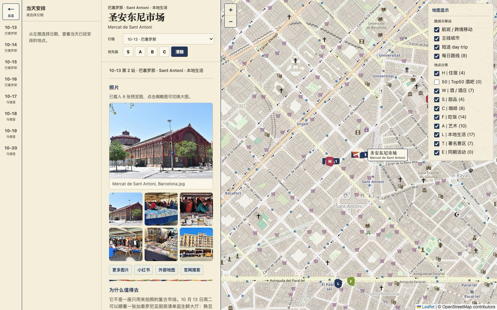

# Interactive Trip Planner

**中文** | [English](README.en.md)

## 把你的生活品味带到陌生城市

它不只是生成景点清单，而是根据你想怎样旅行，结合当地语言资料、代表性景点、社区生活和现实营业信息，安排成一条舒服、可信、可以继续修改的路线。



> 请使用 interactive-trip-planner，帮我规划一趟既有第一次到访重点、也能体验当地生活的旅行。

## 它和普通 AI 攻略有什么不同

| 常见攻略 | Interactive Trip Planner |
| --- | --- |
| 根据热门榜单拼景点 | 先理解旅行方式和取舍，再筛地点 |
| 只使用中文或英文搜索 | 根据目的地生成当地语言检索任务 |
| “local”与著名景点二选一 | 第一次到访时平衡城市代表性与当地生活 |
| POI 只有泛泛推荐语 | 说明到现场做什么、看什么和地点故事 |
| 按热度堆满一天 | 按街区、时间、体力和夜间安全安排动线 |
| 输出静态文字 | 输出可继续加入、移除、排序和保存的交互地图 |

## 你最终会得到什么

- 一份明确旅行主线、取舍和节奏的行程简报。
- 一个经过来源筛选、带选择理由的地点候选池。
- 每天 1–3 个主要锚点，以及同街区的吃喝、休息和替换选项。
- 对节庆、展览、闭馆、预约和易变化事实的复核提醒。
- 一张保留全程总览、每日顺序和编辑状态的交互地图。

地图不是把所有候选都塞进路线。你可以按日期浏览，加入或移除地点，修改优先级和同日顺序，再把变化交给 Codex 复核并重新安排。

## 从品味到陌生城市

Hybrid Taste Model（混合生活品味模型）记录的是可以迁移到新目的地的选择逻辑：你重视什么、避开什么、一天喜欢怎样推进、怎样判断一家店或一个街区值得去，以及偏好的资料和视觉语言。它不会照抄一条固定路线，也不会复制某个人未经整理的购买记录。

你可以直接使用官方模型，让 Skill 根据目的地和旅行方式推荐 1–3 个方向，或选择一主一辅；主模型决定选点和节奏，辅模型只补充一个领域或视觉倾向。0.1 内置两个官方模型：

- `city-craft-rhythm`：城市手艺、建筑、市场、缓慢街区和留白。
- `food-nightlife-locality`：地方饮食、市场、晚餐与短半径夜生活。

贡献者也可以把满意行程背后的选择理由、反偏好和可迁移原则整理成新的版本化模型，而不是提交一份要被复制的店名清单。

## 当地语言和数据源

地点发现遵循五个阶段：

1. 用官方来源建立票务、营业、节庆、交通和安全等事实骨架。
2. 用目的地当地语言寻找本地媒体、论坛和生活方式讨论，发现仅靠中文或英文容易漏掉的线索。
3. 用本次旅行的 Taste Model 筛选真正符合品味、节奏和路线角色的候选。
4. 对进入路线的候选回到近期、官方和可追溯资料逐项核实。
5. 对仍有冲突或临近变化的内容标明检查日期和再次复核的时间。

0.1 的 Regional Source Pack（地区来源包）覆盖 Global Base、中国大陆、日本，以及法国/比利时法语区；它们描述当地的信息生态、检索方法和事实边界。当地语言词库目前覆盖西班牙语和加泰罗尼亚语，只提供稳定检索词，不等于地区来源包。西班牙目前使用 Global Base 加西班牙语/加泰罗尼亚语词条，尚未拥有独立的 Regional Source Pack。

社媒、论坛和本地编辑来源用于发现与体验语境，不会单独证明营业时间、票务、交通或安全。详细规则见[地区来源包](skill/references/regional-source-packs.md)与[来源复核](skill/references/source-verification.md)。

## 如何开始

告诉 Skill 目的地、日期、同行人、预算、体力和你真正关心的体验；不知道选哪种路线也没关系，它会先提出少量会改变选点与节奏的方向。

```text
请使用 $interactive-trip-planner，帮我规划 7 天西班牙旅行。我第一次去，喜欢市场、建筑、甜品和鸡尾酒，但不想每天排满。
```

确认方向后，它会建立事实底座和候选池，安排每日路线，生成可编辑地图，并在你修改后重新核实受影响的营业、预约、交通和容量。

## 0.1 能做什么、还不能保证什么

0.1.0 是 developer preview，可在有人监督的情况下用于真实旅行规划、当地语言研究、每日路线设计和交互地图生成。它已经实现首次到访的代表性景点与当地生活平衡、两套官方 Taste Model、四套来源包、西班牙语/加泰罗尼亚语词库，以及地图的日期浏览、地点详情、加入、移除、排序、保存和重新安排闭环。

它还不能保证每个国家都有专属地区来源包，也不保证搜索结果天然正确或所有路线都经过真实路网复核。节庆、营业、价格、交通、预约、天气和安全信息仍需在出发前按提醒复核；社媒和论坛不能作为这些事实的唯一证据。

当前版本也不等于 Public V1：更广的海外来源包、每个 Taste Model 在更多未见城市上的评估，以及更强的代表性证据仍属于后续工作。公开样例、截图和发布包不得包含真实订单、航班、住宿、姓名、账号、凭据或私人行程；OpenStreetMap 底图与 Wikimedia Commons 图片需要浏览器联网加载。

## 贡献你的品味与地区知识

非开发者可以从一份满意行程开始：说明为什么选择、哪些不适合、怎样控制节奏，以及哪些判断能迁移到别的城市。开发者可以把这些内容提交为受版本控制、可验证的文件：

- Taste Model：遵循[混合生活品味模型规则](skill/references/hybrid-taste-models.md)和现有 [`taste-models`](skill/assets/taste-models/) 结构。
- 地区知识与当地语言：遵循[地区来源包规则](skill/references/regional-source-packs.md)，在 [`source-packs`](skill/assets/source-packs/) 中补充具名来源、检索入口、事实边界、fallback 与词库。
- 视觉主题与目的地 preset：遵循[主题库](skill/references/theme-library.md)、[设计语言](skill/references/design-language.md)和现有 [`themes`](skill/assets/themes/) 结构。
- 代表性行程与样例：遵循[样例约定](skill/assets/samples/README.md)，明确授权、代表理由和隐私复核。

自由文本和社区线索不会直接成为可信事实；贡献必须保留 owner、license、版本、可追溯来源和仓库验证。新增功能或修复可通过 GitHub issue / pull request 提交。

## 安装

**Codex / GitHub 完整版**

1. Clone 或下载此仓库。
2. 将 [`skill/`](skill/) 复制到 Codex skills 目录，并命名为 `interactive-trip-planner`（默认路径为 `~/.codex/skills/interactive-trip-planner/`）。
3. 重新打开 Codex task，然后用 `$interactive-trip-planner` 调用。

**小红书 REDSkill**

使用 [`releases/redskill-0.1.0/interactive-trip-planner/`](releases/redskill-0.1.0/interactive-trip-planner/) 的完整内容；上传或安装步骤见 [REDSkill 安装说明](releases/redskill-0.1.0/INSTALL.zh-CN.md)。这个发布面排除了 Codex metadata，只保留平台支持的文件格式。

## 开发与验证

开发需要 Node.js 18 或更高版本。`skill/` 是源码；`releases/` 是构建产物，请勿直接修改。

```bash
npm run build:redskill
npm test
```

`npm test` 会验证 Core 路线与状态、地图模板、Taste Model、Regional Source Pack、发现脚本、主题合同、Skill contract，以及 REDSkill 的格式和隐私边界。

供 Agent 使用的 JSON CLI 位于 `skill/scripts/`：

```bash
node skill/scripts/recommend-taste-models.js --context <context.json>
node skill/scripts/build-source-query-matrix.js --context <context.json>
node skill/scripts/probe-source-access.js --context <sources.json>
```

每个命令一次只接受 `--context <file>` 或 `--stdin`。Query matrix 只生成检索任务，不访问网络；source probe 只报告有界的访问状态，不能证明地点存在、营业、可订、适合路线或安全。详细输入输出见[生活品味与地区来源线上逻辑](skill/references/taste-and-source-online-logic.md)。

## 仓库结构

```text
interactive-trip-planner/
  skill/                         # Codex Skill 源码、模板、参考与验证脚本
  scripts/                       # 仓库级 REDSkill 构建与验证入口
  docs/                          # 产品设计与发布文档
  releases/redskill-<version>/   # 生成的 REDSkill 发布包
```

旅行规划的六阶段工作流和地图交互合同位于 [`skill/references/`](skill/references/)；可复用模板、Taste Model、Source Pack、主题和公开样例位于 [`skill/assets/`](skill/assets/)。
